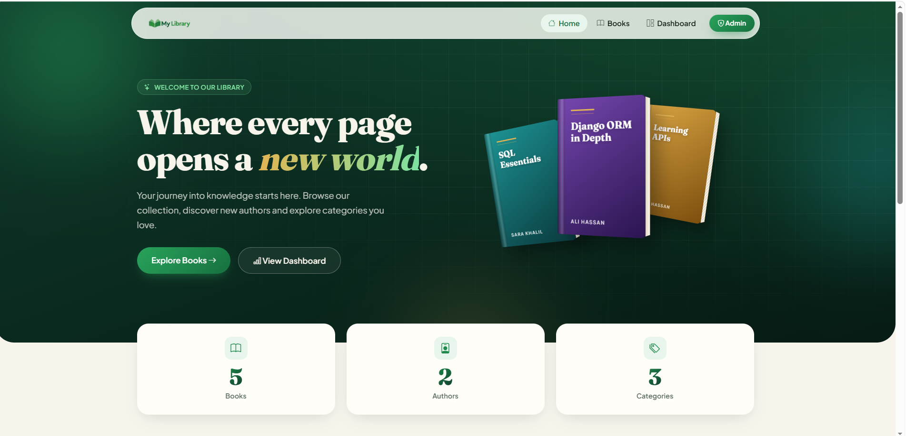
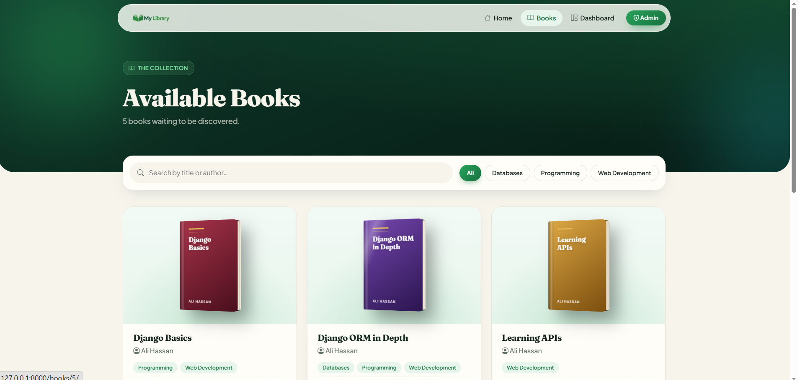
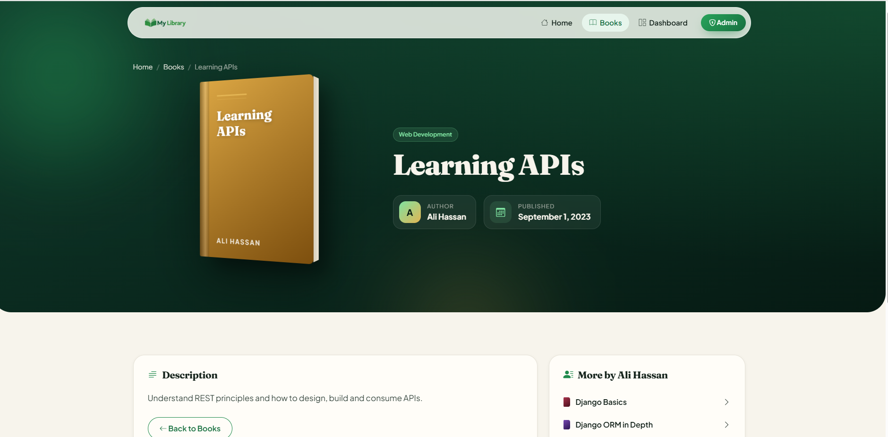
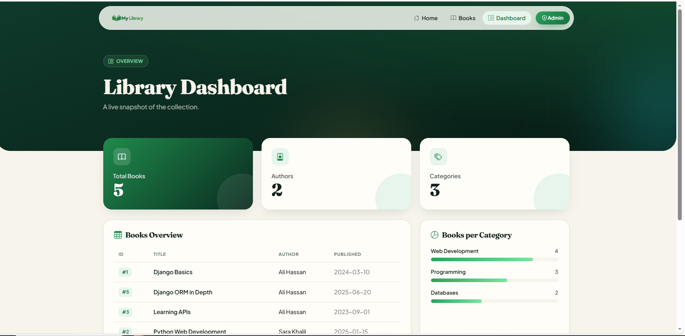
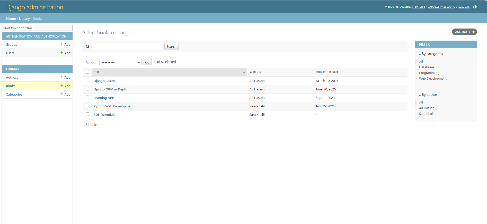
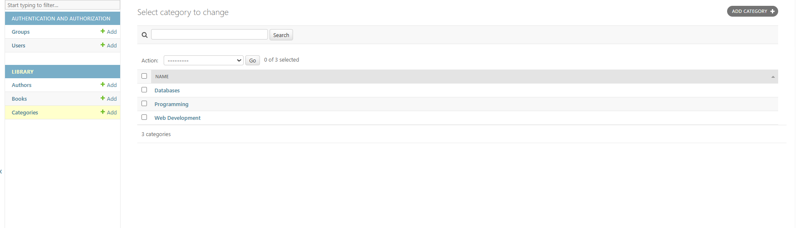
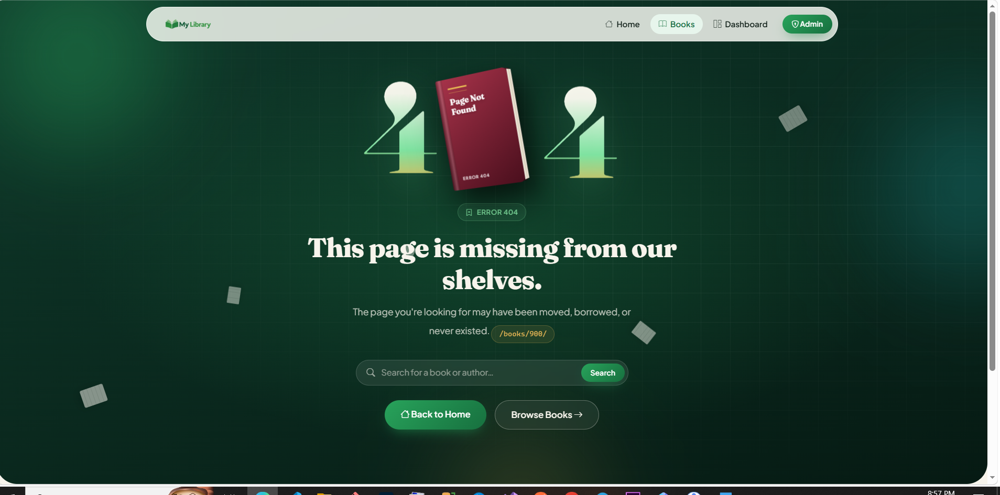

# 📚 My Library — Django Library Management Website

**Django Assignment #4 — Models, Migrations, Relationships & Detail Pages**

A library website built with Django and SQLite. Books, authors and categories are stored in the database, managed through the Django Admin, and displayed on a book list page and a detail page for each book.



---

## ✅ Assignment Checklist

| Requirement | Where to find it |
|---|---|
| **A.** `Author` model (`name`, `email`) | [`library/models.py`](library/models.py) |
| **A.** `Category` model (`name`) | [`library/models.py`](library/models.py) |
| **A.** `Book` model (`title`, `description`, optional `published_date`) | [`library/models.py`](library/models.py) |
| **A.** `Book → Author` via `ForeignKey` (one author, many books) | `Book.author` |
| **A.** `Book ↔ Category` via `ManyToManyField` | `Book.categories` |
| **A.** `__str__` on every model | [`library/models.py`](library/models.py) |
| **B.** Migrations | [`library/migrations/0001_initial.py`](library/migrations/0001_initial.py) |
| **C.** `Author`, `Book`, `Category` registered in the admin | [`library/admin.py`](library/admin.py) |
| **C.** 2+ authors, 3+ categories, 5+ books, each linked | [`library/fixtures/sample_data.json`](library/fixtures/sample_data.json) |
| **D.** `/books/` list page (title, author, categories) using a QuerySet, `render()` and `context` | `books_view` in [`library/views.py`](library/views.py) |
| **D.** "No books available." message when the database is empty | [`templates/books.html`](templates/books.html) |
| **E.** `/books/<int:book_id>/` detail page (title, description, author, categories) | `book_detail_view` in [`library/views.py`](library/views.py) |

---

## 🚀 How to Run

**Requirements:** Python 3.9 or newer.

### 1. Open the project folder

```bash
cd django-library-management-solaris
```

### 2. Create and activate a virtual environment

**Windows (PowerShell / CMD):**

```powershell
python -m venv venv
venv\Scripts\activate
```

**macOS / Linux:**

```bash
python3 -m venv venv
source venv/bin/activate
```

### 3. Install the dependencies

```bash
pip install -r requirements.txt
```

### 4. Create the database tables

```bash
python manage.py migrate
```

### 5. Load the sample data

This adds **2 authors, 3 categories and 5 books**, already linked to each other:

```bash
python manage.py loaddata sample_data
```

### 6. Create an admin account

```bash
python manage.py createsuperuser
```

Enter any username, email and password when prompted.

### 7. Start the server

```bash
python manage.py runserver
```

Then open **http://127.0.0.1:8000/** in your browser.

---

## 🔗 Pages to Test

| Page | URL | What to check |
|---|---|---|
| Home | http://127.0.0.1:8000/ | Live counts of books, authors and categories |
| Book list | http://127.0.0.1:8000/books/ | Each book's title, author and categories |
| Book detail | http://127.0.0.1:8000/books/1/ | Title, description, author and categories (try IDs `1` to `5`) |
| Missing book | http://127.0.0.1:8000/books/999/ | Returns a **404** page (see below for the custom design) |
| Dashboard | http://127.0.0.1:8000/dashboard/ | Statistics and books per category |
| Admin | http://127.0.0.1:8000/admin/ | Log in with the account from step 6 |

**To see the "No books available." message:** delete all books from the admin panel (or skip step 5), then open `/books/`.

**To see the custom 404 page:** Django shows its own debug page while `DEBUG` is on. To preview the custom page, start the server with debug turned off (`--insecure` keeps CSS and images loading):

```powershell
# Windows (PowerShell)
$env:DJANGO_DEBUG="False"; python manage.py runserver --insecure
```

```bash
# macOS / Linux
DJANGO_DEBUG=False python manage.py runserver --insecure
```

Then open http://127.0.0.1:8000/books/999/ or any unknown URL.

---

## 🧪 Running the Tests

```bash
python manage.py test library
```

The 12 automated tests check:

- each model's `__str__` method
- that `published_date` is optional
- the one-to-many (`ForeignKey`) and many-to-many relationships
- that every page loads with the correct template
- the book list shows each book's title, author and categories
- the "No books available." message on an empty database
- the detail page shows the title, description, author and categories
- a non-existent book ID or unknown URL returns the custom 404 page

---

## 🗂️ Data Model

```
Author 1 ──────< Book >────── * Category
(name, email)   (title,          (name)
                 description,
                 published_date)
```

- **Author → Book:** one-to-many (`ForeignKey`, `related_name="books"`), so `author.books.all()` returns an author's books.
- **Book ↔ Category:** many-to-many (`ManyToManyField`, `related_name="books"`), so a book can have several categories and a category can contain many books.
- Author email and category name are unique, which prevents duplicates.
- `published_date` is optional (`null=True, blank=True`).

---

## ⚙️ Implementation Notes

- **Efficient queries:** the list and detail views use `select_related("author")` and `prefetch_related("categories")`, so the authors and categories for all books load in a fixed number of queries instead of one query per book (the N+1 problem).
- **404 handling:** the detail view uses `get_object_or_404`, so an unknown ID returns a proper 404 page instead of an error.
- **Admin:** list columns, search, filters by author and category, and a two-panel selector for choosing categories.
- **URLs:** templates link to books with `book.get_absolute_url`, so links are never hard-coded.
- **Front end:** Bootstrap 5 with a custom design, scroll and hover animations, live search and category filtering on the book list, and a responsive layout for mobile. Animations turn off automatically for users who enable "reduce motion" on their device.

---

## 📁 Project Structure

```
├── config/                 # Project settings and root URLs
├── library/
│   ├── models.py           # Author, Category, Book
│   ├── admin.py            # Admin registration and configuration
│   ├── views.py            # Home, book list, book detail, dashboard
│   ├── urls.py             # App routes, including <int:book_id>/
│   ├── tests.py            # Automated tests
│   ├── migrations/         # Database migrations
│   └── fixtures/
│       └── sample_data.json
├── templates/              # HTML templates (base layout, pages, components)
├── static/                 # CSS, JavaScript and images
├── screenshots/
├── manage.py
└── requirements.txt
```

---

## 📸 Screenshots

| Book list | Book detail |
|---|---|
|  |  |

| Dashboard | Admin — Books |
|---|---|
|  |  |

| Admin — Categories | Custom 404 page |
|---|---|
|  |  |
